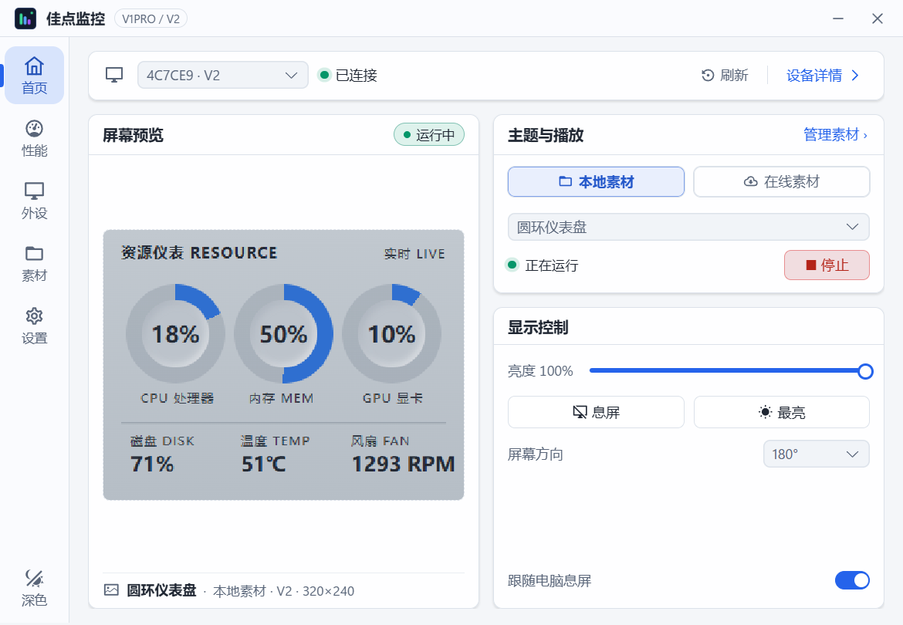
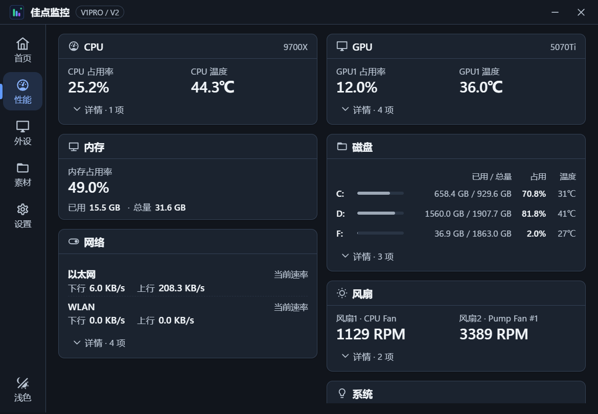
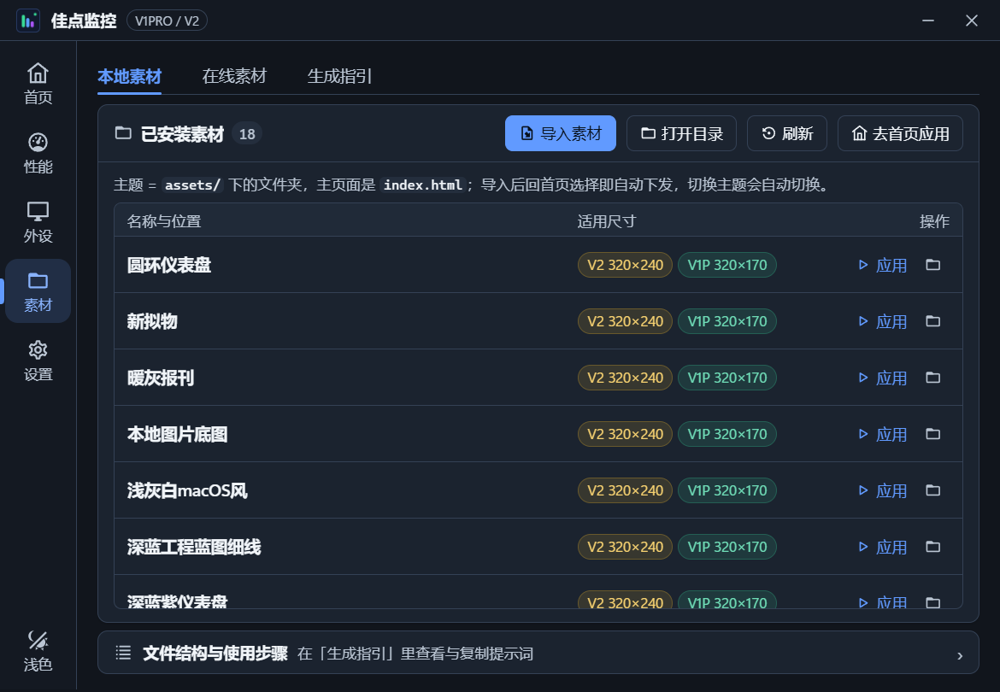
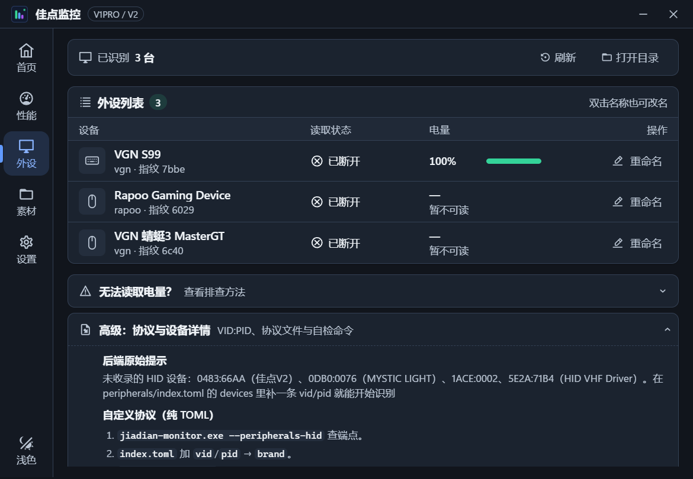
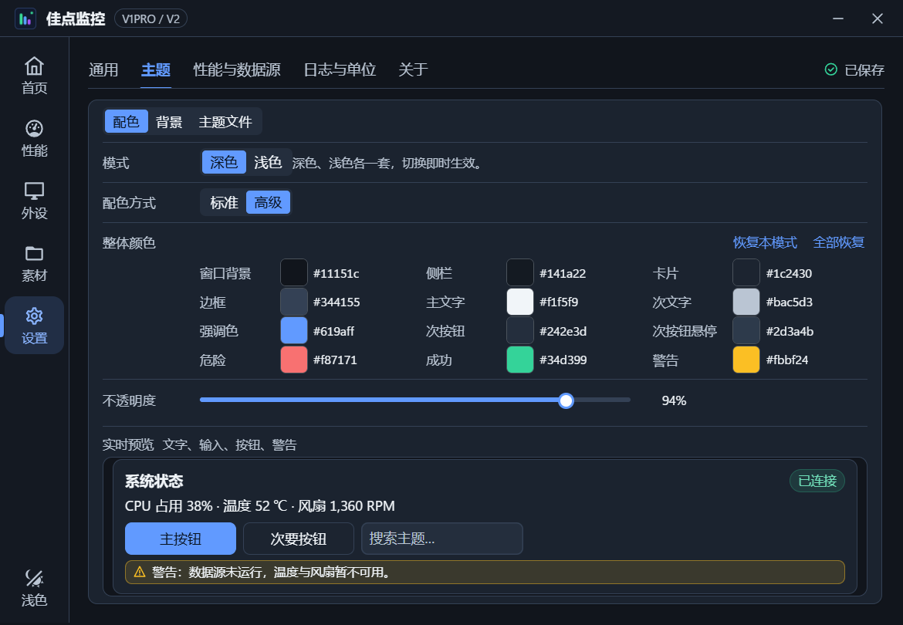

# 佳点监控

把电脑的实时状态，放到一块随手可见的小屏上。

佳点监控（Jiadian Monitor）是一款 Windows 桌面程序：它采集 CPU、显卡、内存、磁盘、网络、风扇与外设电量，渲染成一块可自定义的 HTML 面板，再通过 USB 增量推送到 **佳点 V1P / V2** 小屏。



---

## 能做什么

- **实时推屏**：只推变化区域，画面静止时自动降频，不白占 USB 和 CPU。
- **两种尺寸自适应**：V1P 320×170、V2 320×240，同一套素材可按尺寸分别适配。
- **主题随便换**：18 套内置面板；也可以导入自己的 HTML 素材，或在首页直接切在线页面。
- **界面也能自定义**：深 / 浅两套配色、9 种取色算法、12 个语义颜色、背景图、不透明度，全部实时预览。
- **外设电量**：鼠标、键盘、耳机等 HID 设备的电量与连接状态，协议用 TOML 配置，新设备不用等更新。
- **显示控制**：亮度、旋转、跟随电脑息屏，一次设置直接下发。
- **拔插自愈**：USB 掉线自动重新枚举接管，整屏重发，不会停在「运行中但没画面」。
- **和官方上位机共存**：不用退出官方 GUI，程序会通过本地接口借用 USB 使用权。

## 界面

### 首页：预览、主题、显示控制

左边是设备画面的实时预览，右边切换本地 / 在线素材，下面调亮度、方向和息屏跟随。

### 性能：一眼看到整机状态

CPU、GPU、内存、磁盘、网络、风扇、系统信息分卡片展示；悬停只展示确定的数据，不猜。



### 素材：导入、管理和生成指引

素材就是一层文件夹，里面放 `index.html` 和图片；导入后回首页选择即自动下发。内置「生成指引」，可以把提示词直接交给 AI 生成新面板。



### 外设：电量、协议与排查

自动识别鼠标 / 键盘 / 耳机，显示电量与状态；支持重命名、查看原始提示和 TOML 协议说明。



### 主题：标准与高级两种调法

- **标准**：选一个种子色 + 一种 Material 3 算法，自动生成深 / 浅两套可访问配色。
- **高级**：逐项调整窗口、侧栏、卡片、边框、文字、按钮、危险 / 成功 / 警告等 12 个语义颜色。
- 背景支持一张图片，缩放方式、位置、不透明度都保存在 `Theme/theme.toml`。
- 「保存为主题」可把当前主题另存到任意文件夹；主题名双击即可改（只改 TOML 标题，不改文件夹）。



---

## 快速开始

### 直接使用

1. 打开 [Releases](https://github.com/xhyyd2022/jiadian-monitor/releases) 下载最新的 `jiadian-monitor-v*.zip`。
2. 解压到一个固定目录（不要只解压 exe，素材和外设协议在旁边的文件夹里）。
3. 双击 `jiadian-monitor.exe`。
4. 用 USB 连接设备，首页选择主题，点「启动」。

便携目录大致是这样：

```text
jiadian-monitor.exe
settings.ini        设置（自动生成，可手工编辑）
assets/             面板素材（一个主题一层文件夹）
Theme/              应用界面主题（theme.toml + 可选背景图）
peripherals/        外设协议（index.toml + brands/*.toml）
online/             在线素材配置
log/                运行日志
```

> 程序按「exe 同级 → 当前工作目录」的顺序查找 `assets/`、`peripherals/`、`online/`。

### 环境要求

| 项 | 要求 |
| --- | --- |
| 系统 | Windows 10 / 11 x64 |
| WebView2 | 一般已内置；缺失时安装 Evergreen Runtime |
| 设备 | 佳点 V1P（320×170）或 V2（320×240），WinUSB 连接 |
| 数据源（可选） | LibreHardwareService；不装也能看网络、磁盘容量等 Win32 指标 |

---

## 主题与素材

### 应用界面主题

设置 →「主题」控制的是**程序界面**，不是设备上的面板。主题数据都在 exe 同级的 `Theme/`：

```text
Theme/
  theme.toml        深 / 浅两套配色、背景图、缩放、位置、不透明度
  background.png    可选，一张背景图
```

- 改完自动保存，立即生效。
- 删除 `Theme/` 会按默认值重建。
- 主题包可直接备份或分享；「保存为主题」会连同背景图一起复制。

### 面板素材

一个面板主题是 `assets/<主题名>/` 下的一层文件夹：

```text
assets/圆环仪表盘/
  index.html        320×240 或按尺寸分目录
  bg.png            可选，和 HTML 同层
```

内置 18 套素材。也可以点「导入素材」把自己做的文件夹放进来，或使用「生成指引」让 AI 生成。

**素材生成技能**：完整的提示词、检查脚本和 16 套已验收样例在
[jiadian-monitor-skills](https://github.com/xhyyd2022/jiadian-monitor-skills)。

### 在线素材

在线素材就是一条 URL：页面托管在云端或局域网，自己从本机 `127.0.0.1:8766` 取数。程序负责渲染、抓帧和 USB 下发。

- `https://` 任意站点可用；`http://` 仅限本机与局域网私有地址。
- 云端只需要静态页面，硬件数据不出本机。
- 详细约定见 [ONLINE_MODE.md](ONLINE_MODE.md)。

---

## 外设电量

外设走 HID，不占用设备的 WinUSB 通道。协议是纯 TOML：

```text
peripherals/
  index.toml          按 VID/PID 绑定品牌
  brands/<品牌>.toml  每个品牌的查询帧、回包解析、档位
```

支持鼠标、键盘、耳机、手柄、接收器等类别；新增设备通常只需要补一条 `vid/pid` 和品牌协议，不用重新编译。

---

## 数据来源

- **LibreHardwareService（LHS）**：CPU / GPU / 内存 / 温度 / 风扇 / 功耗等。程序内可一键下载、校验 sha256、安装。
- **Win32**：磁盘容量、网络速率、开机时长等不依赖 LHS 的指标。
- **HID**：外设电量与连接状态。
- **本地 API**：程序在 `127.0.0.1:8766` 提供 `/metrics`、`/units`、`/peripherals` 等只读接口，供面板取数。

与官方上位机共用设备时，通过 `/usb/handoff/*` 申请 / 续期 / 归还 USB 使用权，不需要退出官方 GUI。

---

## 本地开发

前置：**Node.js 20+**、**Rust stable（MSVC）**、**Visual Studio 2022 生成工具（C++ 桌面开发）**。

```powershell
npm install
npm run tauri dev      # 开发模式（Vite 热更新 + 原生窗口）
npm run tauri build    # 生产构建
```

构建产物：

- `src-tauri/target/release/jiadian-monitor.exe`
- 完整便携包由 `scripts/build.ps1` 生成：exe + `assets/` + `peripherals/` + `online/` + 卸载脚本 + 许可证。

> 公开仓库的 `assets/` 只放程序图标，不包含主题素材；云端 Release 的 zip 因此不含主题。需要开箱即用的完整主题，请用本地 `bin/` 打出的完整包。

### 技术栈

- 前端：Vue 3 + TypeScript + Vite + Element Plus
- 后端：Rust + Tauri 2
- 渲染：隐藏 WebView2 + CDP 抓帧
- 传输：WinUSB + LIVE 协议（RGB565、脏矩形、最多 6 区域）

更细的协议、接口和目录说明见 [ONLINE_MODE.md](ONLINE_MODE.md)、[`peripherals/README.md`](peripherals/README.md) 与 `src-tauri/src/`。

---

## 许可证与第三方

主程序代码采用 **PolyForm Noncommercial License 1.0.0**：源码可见，允许个人、研究、实验等非商业用途，**禁止商业使用**。详见 [LICENSE](LICENSE)。

**面板素材**（含内置主题与生成的作品）与 **[素材生成技能](https://github.com/xhyyd2022/jiadian-monitor-skills)** 采用 **CC BY-NC-SA 4.0**：允许非商业复制、修改、再分发，需署名、注明修改并以相同许可共享。

程序静态链接 / 打包了 Vue、Tauri、Element Plus、Material Color Utilities 等第三方组件；LibreHardwareService 是独立第三方软件（MPL-2.0），仅在用户确认后安装。完整清单与许可证见 [THIRD-PARTY-NOTICES.md](THIRD-PARTY-NOTICES.md)。
